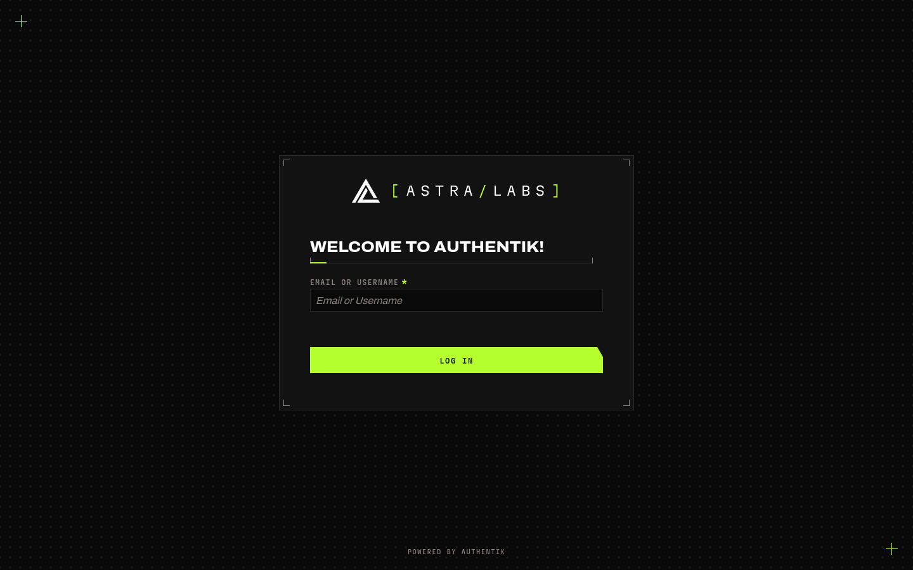

<p align="center">
  
</p>

<h1 align="center">AstraLabs for authentik</h1>

<p align="center">
  Custom CSS and brand assets that put <a href="https://auth.astralabs.dev">auth.astralabs.dev</a> in the AstraLabs style:<br>
  carbon ground, Bone text, Acid for interaction, square corners, hairline rules and mono labels.
</p>

<p align="center">
  <a href="#install"><b>Install</b></a>
  &nbsp;·&nbsp;
  <a href="#whats-styled">What's styled</a>
  &nbsp;·&nbsp;
  <a href="#editing-the-css">Editing the CSS</a>
  &nbsp;·&nbsp;
  <a href="#recovery">Recovery</a>
</p>

---

## What's in here

| File | Purpose |
|---|---|
| `astralabs.css` | The theme. Paste it into the brand's **Custom CSS** field. |
| `branding/astralabs-lockup.svg` | Mark and `[ASTRA/LABS]` wordmark, used as the brand logo. |
| `branding/astralabs-favicon.svg` | White mark on a carbon square, used as the favicon. |
| `branding/astralabs-mark.svg` | The mark on its own, for anywhere a square logo fits better. |
| `branding/astralabs-flow-background.svg` | Carbon with the 16px dot grid, used as the default flow background. |

Tested on authentik **2025.10.3** and **2026.2.7**. The two versions lay the login page out differently (2026 uses a CSS grid and adds a language selector); the CSS handles both. It also sets the semantic `--ak-color-*` variables from authentik's newer docs.

---

## Install

### 1. Copy the logos into the branding volume

The compose file already mounts a `branding` volume at `/web/dist/assets/icons/branding`, which authentik serves at `/static/dist/assets/icons/branding/`. From this folder, on the Docker host:

```bash
docker compose -f /path/to/authentik/docker-compose.yml cp branding/. server:/web/dist/assets/icons/branding/
```

Check one loads:

```bash
curl -I https://auth.astralabs.dev/static/dist/assets/icons/branding/astralabs-lockup.svg
```

### 2. Set up the brand

In the admin interface, go to **System → Brands** and edit your brand (the default one, unless you've made another for `auth.astralabs.dev`).

| Field | Value |
|---|---|
| Title | `AstraLabs` |
| Logo | `/static/dist/assets/icons/branding/astralabs-lockup.svg` |
| Favicon | `/static/dist/assets/icons/branding/astralabs-favicon.svg` |
| Default flow background | `/static/dist/assets/icons/branding/astralabs-flow-background.svg` |
| Custom CSS | the whole of `astralabs.css` |

The default flow background is a required field, and authentik's own default is a landscape photo. The CSS paints the dot grid over it either way, but the image still loads, and it shows wherever custom CSS doesn't apply, such as logging in with a recovery key. Individual flows can set their own background under **Flows → (flow) → Appearance**; leave that empty so they use this one.

Then expand **Other global settings** and set **Attributes** to force dark mode. The theme is dark only, and without this a visitor whose browser prefers light mode gets authentik's light base under it:

```yaml
settings:
  theme:
    base: dark
```

Save, then open the login page in a private window to skip any cached copy.

### Or apply it with the API

If you'd rather keep it in version control and push changes from the command line, set `AK_TOKEN` to an API token with permission to edit brands (**Directory → Tokens and App passwords**) and run:

```bash
BRAND=$(curl -s -H "Authorization: Bearer $AK_TOKEN" "https://auth.astralabs.dev/api/v3/core/brands/?default=true" | python3 -c "import sys,json; print(json.load(sys.stdin)['results'][0]['brand_uuid'])")
```

```bash
python3 -c "import json; print(json.dumps({'branding_custom_css': open('astralabs.css').read()}))" | curl -s -X PATCH -H "Authorization: Bearer $AK_TOKEN" -H "Content-Type: application/json" --data @- "https://auth.astralabs.dev/api/v3/core/brands/$BRAND/"
```

---

## What's styled

**Login and enrolment flows**
- Carbon background with a faint 16px dot grid.
- On 2026.x the language selector moves to the top-right corner as a small mono label, so it doesn't sit on the top-left mark.
- Two Acid registration marks on the background. On load, each blinks in and out at three spots with hard cuts, then strobes into its corner (top-left and bottom-right) and holds, like the brand's Registration align. With reduced motion turned on they simply sit in the corners. On phones they sit 16px in.
- The card sits centred in the screen with "Powered by authentik" pinned to the bottom. The page is sized to the visible screen (`dvh`), so phones don't have to scroll past the address bar to reach the footer.
- The card is a plate panel with a hairline border and bone corner ticks, and no shadow.
- The stage title is heavy uppercase Archivo over a measurement rule (an Acid index segment, then a hairline with end ticks).
- Field labels are mono uppercase. Required markers are Acid.
- Inputs are square on carbon with an Acid focus ring. Invalid fields turn the "down" red.
- The primary button is Acid with dark mono text and the brand's single 60° cut in the top-right corner. Secondary buttons are outlined, and links are Bone with an Acid underline.
- "Powered by authentik" and your brand links are small mono labels.
- Alerts use a plate background with a coloured left edge.

**User library**
- Carbon background with the dot grid, square plate application cards with hairline borders and an Acid edge on hover.
- Uppercase page title, mono labels for application groups.

**Admin interface**
- The same palette, fonts and square corners. The current sidebar item gets an Acid bar instead of authentik's orange.
- Status labels (Yes/No and similar) are outlined chips in the status colours, instead of PatternFly's light pastel chips, which put green text on near-white.
- Switches, checkboxes and radios follow the AstraLabs web kit: square, with a 1px ash border on carbon. Switched on, the track and its square knob turn acid and the knob slides across (Snap); checked, an 8px acid square snaps in. Disabled buttons are a quiet outline.

**Notifications (both interfaces)**
- The unread badge on the bell is Acid with dark text.
- The drawer opens above the page, as a plate panel with a mono uppercase heading. Each notification's icon takes its severity colour (Bone for notices, orange for warnings, red for alerts).

**Fonts**
Archivo and Martian Mono load from Google Fonts through two `@import` lines at the top of the CSS. If a reverse proxy in front of authentik sets a Content-Security-Policy, allow `fonts.googleapis.com` and `fonts.gstatic.com`. Authentik itself doesn't set one.

---

## Editing the CSS

Authentik copies the brand CSS into every web component's shadow root, and into a `<style>` element in the page head. A few things follow from that:

- **Don't use the less-than, greater-than or ampersand characters.** The page-head copy escapes them, which breaks any rule that uses them. That rules out child combinators (use a descendant selector instead) and a single Google Fonts URL that loads two families (hence two `@import` lines).
- **Variables are set three ways** so the theme survives upgrades: authentik 2025.x builds its dark theme from `--ak-dark-*`, 2026.x adds `--ak-font-family-*` and `--ak-v2-*`, and PatternFly 4 `--pf-global--*` variables sit underneath both.
- **Page-level rules need extra specificity.** Authentik's own stylesheets are adopted after the page `<style>`, so the tokens use `html:root` and the background uses `html body` to win there.
- **Upgrades can move things.** Rules that target PatternFly classes (`.pf-c-login__main`, `.pf-c-button.pf-m-primary`, …) depend on authentik's markup. After an upgrade, check the login page, the library and the admin interface.

---

## Recovery

If a CSS change locks you out of the login page, create a recovery link. Logging in with it disables custom CSS for that session, so you can fix or clear the brand's CSS:

```bash
docker compose run --rm server create_recovery_key 10 akadmin
```

---

## A note on the compose file

The `server` service defaults to `AUTHENTIK_TAG` `2025.10.23`, which doesn't exist, while `worker` defaults to `2025.10.3`. If `stack.env` sets `AUTHENTIK_TAG`, both use that and it doesn't matter. If it doesn't, the server can't pull its image. Use the same tag for both.

---

## Licence

Copyright © 2026 Emily Astranova. Licensed under the [GNU Affero General Public License v3.0](../LICENSE).
