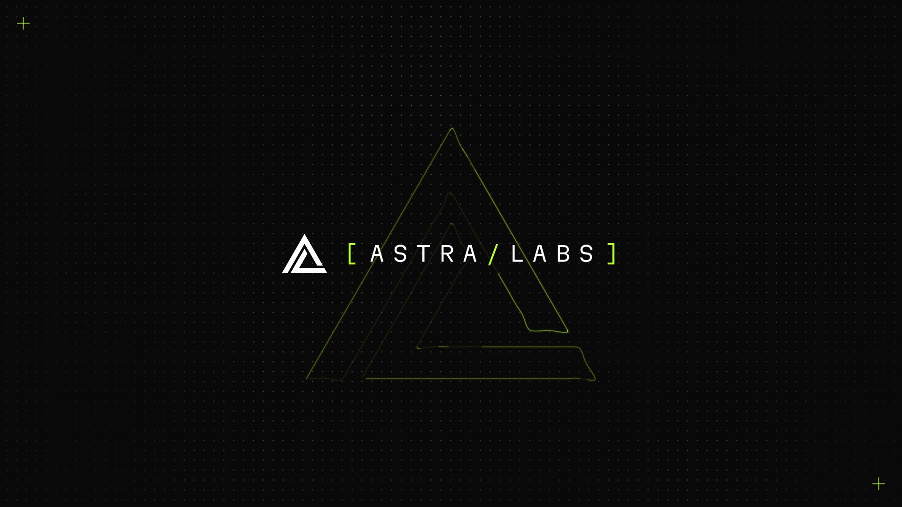
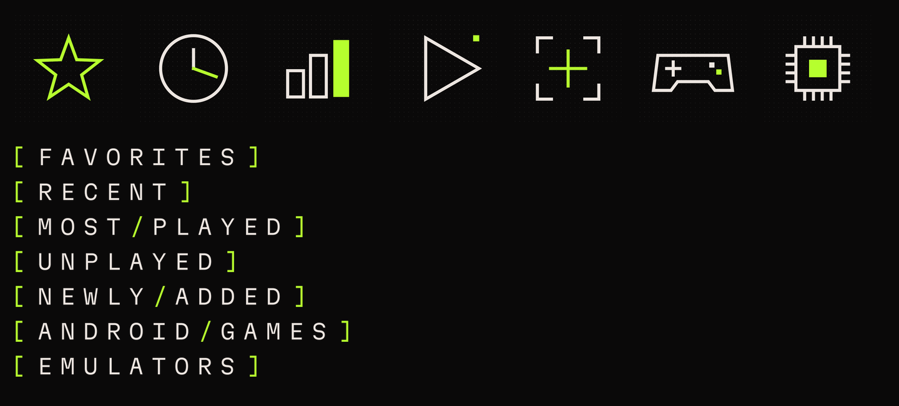

<h1 align="center">AstraLabs for Cocoon</h1>

<p align="center">
  
</p>

<p align="center">
  A theme for the <a href="https://cocoon-shell.com">Cocoon</a> launcher in the AstraLabs design language.
</p>

---

## What's in it

| Part | What it does |
|---|---|
| **Colors** | Void background, Plate cards and tiles, Rule borders and dividers, Bone text, Ash secondary text. Acid is the accent and the cursor. No drop shadows, no inner shadows, no glow. |
| **Settings** | Square tiles (`icon_roundness` 0), square dock icons, flat Bone-tinted icons, solid panels, and the static corner cursor, which reads as the brand's corner ticks. Fullscreen heroes with a black gradient so logos stay legible. |
| **Wallpapers** | `main` (1920×1080): the lockup over the dot field in its Sea idle. Twice per 48-second loop the oscilloscope beam from astralabs.dev plays behind it, once as a Lissajous figure and once drawing the mark. `external` (1240×1080): the dot field alone with the corner plus marks, quiet behind the UI. Both are 30 fps VP9 loops that join without a seam. |
| **Smart folders** | Icon, hero and logo for Favorites, Recent, Most played, Unplayed, Newly added, Android games and Emulators. Icons are line art in Bone with one Acid detail. Logos are set like the wordmark: `[MOST/PLAYED]`. |
| **Sounds** | 22 short synthesized sounds: sine ticks, stepped blips and relay clicks, like lab equipment. Pitches step rather than slide, after the brand's Flick motion. |

<p align="center">
  
</p>

The theme leaves music, volumes and the dock layout as they are. It doesn't include icon overlays for platforms.

---

## Install

Build the ZIP (see [Rebuilding](#rebuilding)), or take `dist/astralabs-cocoon.zip` if it's already built, and copy it to the device. Then:

1. Open **Settings → Personalization → Theme** in Cocoon.
2. Choose **Import ZIP** and select `astralabs-cocoon.zip`.
3. Pick **AstraLabs** in the Theme picker and apply it, including **Theme Settings**, so the square tiles and corner cursor take effect.

To install it unpacked instead, copy the `astralabs/` folder into `Cocoon/themes/` on the device and restart Cocoon.

**Battery.** The video wallpapers are light (VP9 at 30 fps, about 2 MB together), but a still image uses less power. `extras/wallpapers/` has WebP stills of both; choose them under **Settings → Personalization → Wallpapers**.

---

## Layout

```
cocoon/
  astralabs/              the theme, exactly as Cocoon reads it
    theme.json
    preview.png
    wallpapers/           main.webm, external.webm
    sounds/               *.ogg, named after Cocoon's sound events
    smart_folders/<key>/  icon.png, hero.png, logo.png
  branding/               the lockup and mark the renders use
  extras/wallpapers/      still versions of the wallpapers
  tools/                  render and packaging scripts, plus Martian Mono (SIL OFL 1.1)
  docs/images/            README images
  dist/                   the built ZIP (not committed)
```

---

## Rebuilding

Everything except `theme.json` is rendered by the scripts in `tools/`. They need Python 3 with `numpy`, `pillow`, `cairosvg` and `pycairo`, and `ffmpeg` built with `libvpx-vp9` and `libvorbis`. On Fedora, `pycairo` comes from the `python3-cairo` package, so make the virtual environment with `--system-site-packages`.

```bash
python3 -m venv --system-site-packages .venv && .venv/bin/pip install numpy pillow cairosvg
cd tools
../.venv/bin/python render_wallpapers.py      # videos, stills, preview.png and README shots (a few minutes)
../.venv/bin/python render_smart_folders.py
../.venv/bin/python render_sounds.py
../.venv/bin/python build_zip.py              # checks the theme, then writes dist/astralabs-cocoon.zip
```

`render_wallpapers.py --frames` writes a few check frames to `docs/images/` without encoding anything, and `render_wallpapers.py main` re-encodes only one video. `build_zip.py` refuses to build if a referenced file is missing, a color isn't `#RRGGBB` or `#AARRGGBB`, or a sound or folder name isn't one Cocoon knows.

The dot field, the Sea idle and the scope beam are ports of the astralabs.dev home page, scaled 1.5× because a handheld's 1080p panel is much denser than a desktop monitor.

---

## Tested

Built against the [Theme JSON Reference](https://cocoon-shell.com/wiki/theme-json-reference/) and the layout of a published Silk theme. Not yet tried on a device: check the cursor and selection colors on both screens, and that the Acid accent leaves button text readable.
